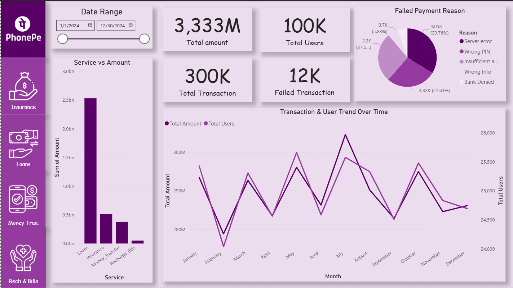
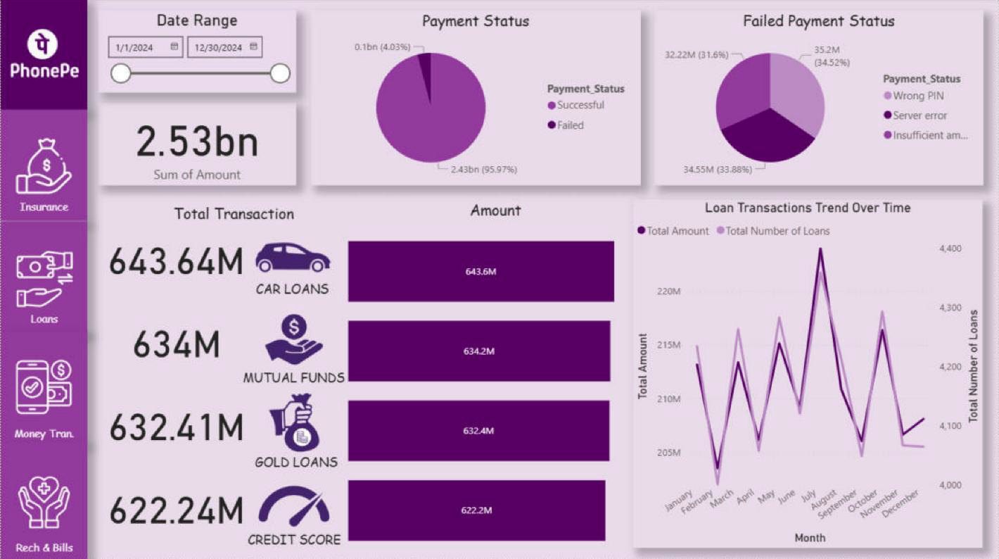
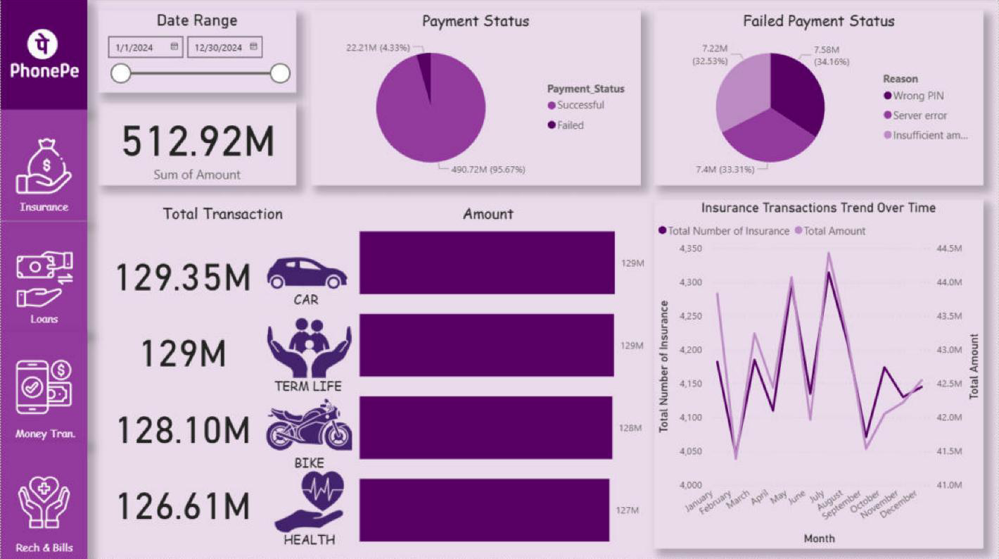
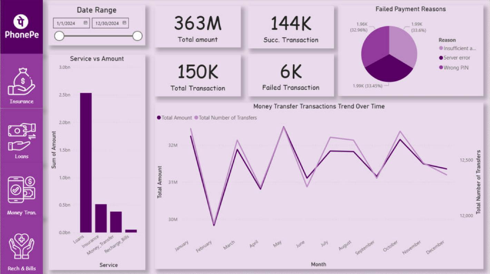
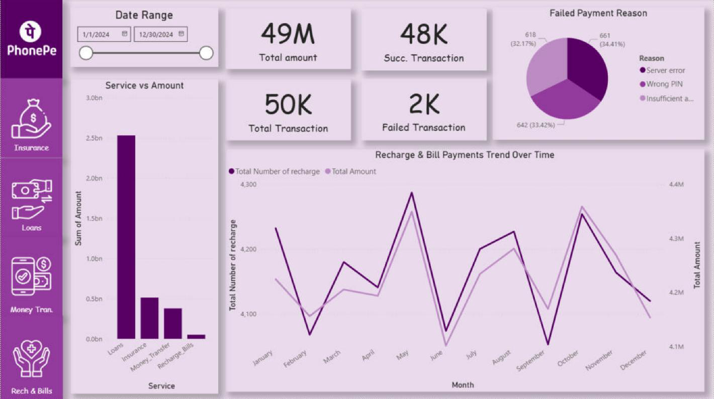

# PhonePe Financial Services Analysis Dashboard

A multi-page **Power BI** dashboard for a PhonePe-style digital payments platform. It covers transactions, users, failed payments and four services: Loans, Insurance, Money Transfer, and Recharge & Bills.



**Tools:** Power BI · Power Query · DAX · Excel

---

## Key findings

All numbers are for Jan–Dec 2024 and come from the dashboard.

1. **Loans bring in about 76% of the money.** Loans account for 2.53bn of the 3,333M total. Insurance, Money Transfer and Recharge & Bills share the rest, and Recharge & Bills is the smallest. Most transactions are small payments, but most of the value comes from loans.
2. **4% of transactions fail, and the biggest cause is on the platform side.** 12K of 300K transactions failed. Server errors cause 33.8% of failures, more than Wrong PIN (27.6%) or Insufficient balance (27.5%). Fixing server errors would recover the most failed payments.
3. **The four loan types bring in almost the same amount.** Car loans (643.6M), mutual funds (634.2M), gold loans (632.4M) and credit score (622.2M) are within 3.5% of each other. No single product drives loan revenue. This even spread is also typical of synthetic data (see below).

---

## Dataset

- **Source:** I built this by following Top Varsity's guided [PhonePe End-to-End Data Analysis Project](https://topvarsity.in/phone-pe-end-to-end-data-analysis-project-best-power-bi-project-for-data-analyst-top-varsity/). The dataset, icons, colour theme and 5-page layout come from that project. The key findings above are my own analysis.
- **This is synthetic or sample data, not real PhonePe data.** It has 100K users and 300K transactions, all in 2024.
- **Tables:** `All_Users`, `All_Transactions`, `Recharge_Bills`, `Money_Transfer`, `Loans`, `Insurance`

The raw Excel file is not in this repo, but the data is embedded in the `.pbix` file.

---

## How to open

1. Download [`PhonePe_Dashboard.pbix`](PhonePe_Dashboard.pbix). It is about 30 MB.
2. Open it in **Power BI Desktop** (free, Windows).
3. Use the side menu to switch pages and the date slider to filter.

---

## Dashboard pages

| Page | What it shows |
|---|---|
| Home | Total amount, users, transactions, failed transactions, amount by service, monthly trend, failure reasons |
| Loans | Amount by loan type, payment status, failure reasons, monthly trend |
| Insurance | Amount by insurance type (car, term life, bike, health), payment status, failure reasons, monthly trend |
| Money Transfer | Monthly transfer count and amount |
| Recharge & Bills | Monthly recharge count and amount |

<details>
<summary>More screenshots</summary>

### Loans


### Insurance


### Money Transfer


### Recharge & Bills


</details>

---

## Repository structure

```
├── PhonePe_Dashboard.pbix   # Power BI report (with data)
├── images/                  # Dashboard screenshots
├── project_doc/             # Walkthrough, data dictionary, dataset notes
├── BRD.txt                  # Business requirements document
└── README.md
```

---

## Author

**Sanjay Sathish Kumar** · [GitHub](https://github.com/Sanjay5704) · [LinkedIn](https://www.linkedin.com/in/sanjaysathishkumar)
